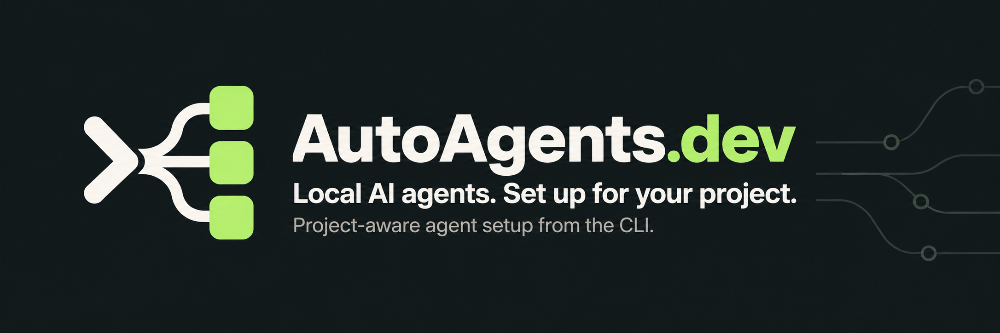

# AutoAgents.dev

A CLI for automatically setting up local AI agents based on your project.

Project-aware setup, so your local AI workflow starts with the tools suited to the code you are working on.

